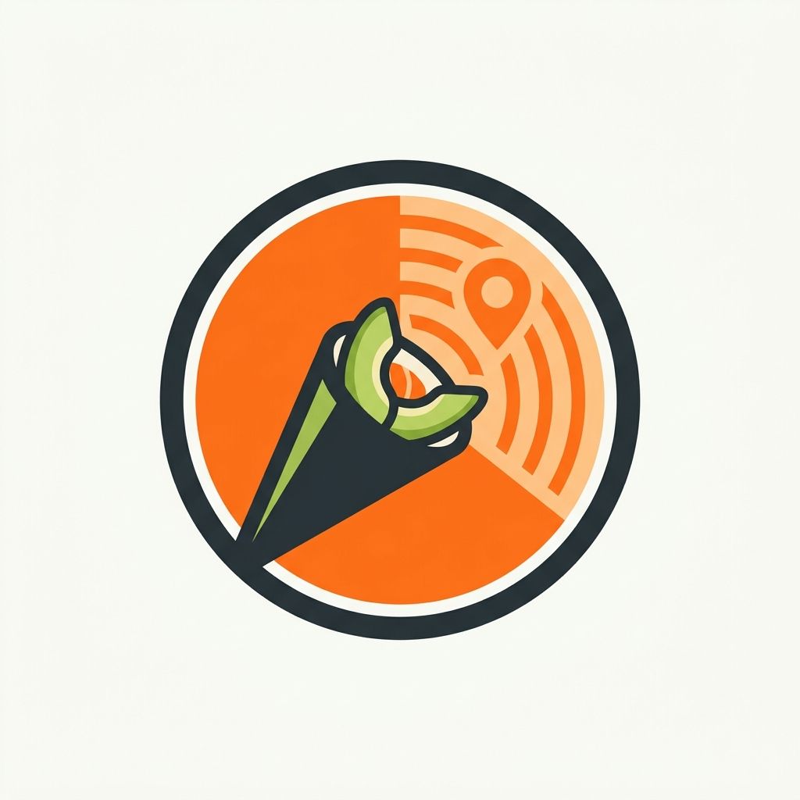

# 🥪 Bajonero 🇨🇱

<p align="center">
  
</p>

<p align="center">
  <b>El mapa colaborativo definitivo del bajón callejero en Chile</b><br>
  <i>Handrolls, Completos Italianos, Sopaipillas y Opciones Vegetarianas en las 16 regiones de Chile.</i>
</p>

---

## 🌟 Características Principales

- 🗺️ **Mapa Interactivo Nacional (16 Regiones):** Catálogo de picadas callejeras desde Arica hasta Punta Arenas.
- 🥦 **Filtro 'Alternativa Sana':** Encuentra locales con opciones vegetarianas, integrales o combos sin azúcar añadida.
- 🎓 **Modo Estudiante (< $3.000):** Detección de cercanía a sedes universitarias con filtrado instantáneo de bajones económicos.
- 📍 **Ruta GPS Directa:** Integración en un toque con Google Maps para llegar caminando o en micro/metro.
- 👥 **Comunidad & Sugerencias:** Formulario interactivo y Empty State para que los usuarios agreguen nuevos carritos y picadas al mapa.

---

## 📱 Requisitos del Sistema

- **Sistema Operativo:** Android 8.0 (Oreo, API 26) o superior.
- **Arquitectura:** Compatible con teléfonos y tablets Android (modo offline incluido con 71 locales precargados).

---

## 🔒 Permisos Declarados (`AndroidManifest.xml`)

| Permiso | Tipo | Justificación |
|---|---|---|
| `INTERNET` | Red | Carga de mosaicos cartográficos e imágenes. |
| `ACCESS_NETWORK_STATE` | Red | Monitoreo del estado de conexión para modo offline. |
| `ACCESS_FINE_LOCATION` | Opcional | Geolocalización precisa para las funciones *Mi Zona* y *Modo Estudiante*. |
| `ACCESS_COARSE_LOCATION` | Opcional | Ubicación aproximada como alternativa a GPS directo. |

*(Los sensores de hardware GPS están declarados como `android:required="false"`, permitiendo que la app se instale en cualquier dispositivo).*

---

## 🚀 Cómo Ejecutar el Proyecto

1. Clonar el repositorio:
   ```bash
   git clone https://github.com/TU_USUARIO/SalvaBajon.git
   ```
2. Abrir en **Android Studio**.
3. Conectar un dispositivo físico o iniciar un emulador con **Android 8.0 (API 26)+**.
4. Presionar **Run 'app'** (`Shift + F10`).
